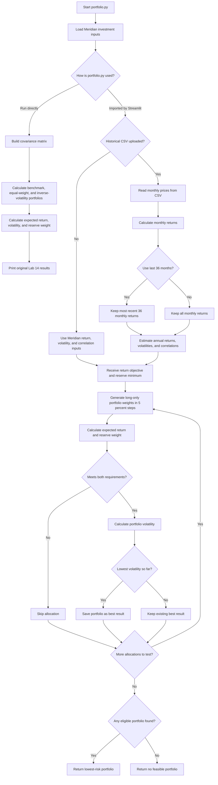

# FIN 43900 — Lab 15: Portfolio Stability Decision

## 1. Lab Objective

The goal of Lab 15 was to build on my Lab 14 portfolio risk engine by creating a lowest-risk portfolio optimizer and an interactive Streamlit application. I tested how changes in expected returns, correlations, and historical estimation periods affected the portfolio that met the investment policy.

I first validated the model using the Meridian training assumptions. I then used actual historical ETF prices to test a portfolio for my Project 2 university scholarship endowment.

## 2. Lab 14 Portfolio Engine

My original `portfolio.py` contained functions for calculating expected portfolio returns, volatility, reserve-eligible weight, and investment policy compliance.

I added a function called `find_lowest_risk_portfolio()` that searches long-only portfolios using 5-percentage-point weight increments. The function selects the portfolio with the lowest volatility that meets the expected-return objective and minimum reserve requirement.

I also added `estimate_historical_inputs()` to calculate annualized historical return estimates, volatilities, and correlations from monthly investment prices.

The original Lab 14 calculations were preserved.

### Lab 14 Baseline Results

| Portfolio | Expected Return | Volatility | Reserve Weight | Meets 6.5% Objective? |
|---|---:|---:|---:|---|
| Benchmark | 6.80% | 10.46% | 0.00% | Yes |
| Equal weight | 5.20% | 5.21% | 50.00% | No |
| Inverse volatility | 3.77% | 1.05% | 90.30% | No |

These results matched my original Lab 14 output.

## 3. Streamlit Application

I created `app.py` to make the portfolio model interactive.

The application allows the user to adjust the expected-return objective, minimum reserve weight, investment return estimates, and reserve eligibility. It also allows historical prices to be uploaded through a CSV file and provides an option to use only the last 36 monthly returns.

The application displays the original as-loaded portfolio and the current lowest-risk portfolio so the results can be compared.

## 4. Meridian Validation Tests

Before using my own investment data, I tested the model against the Meridian examples provided in Lab 15.

### Test 1 — Original Meridian Assumptions

| Investment | Portfolio Weight |
|---|---:|
| Treasury bills | 0% |
| Treasury 10-year note | 20% |
| Investment-grade bond fund | 25% |
| Global equity index fund | 55% |

- Expected return: 6.51%
- Volatility: 9.44%
- Reserve-eligible weight: 20.00%
- Return objective: 6.50%
- Minimum reserve requirement: 3.00%

The model produced the expected original Meridian allocation.

### Test 2 — Lower Equity Return

For the second test, I decreased the global equity index fund's expected annual return from 8.00% to 7.00%.

| Investment | Portfolio Weight |
|---|---:|
| Treasury bills | 0% |
| Treasury 10-year note | 10% |
| Investment-grade bond fund | 10% |
| Global equity index fund | 80% |

- Expected return: 6.53%
- Volatility: 12.94%
- Reserve-eligible weight: 10.00%
- Largest weight change: 25 percentage points

The portfolio changed significantly when the expected equity return decreased. The optimizer increased the equity allocation to 80% to meet the required return, even though the estimated portfolio volatility increased.

This showed me that a change in one expected-return assumption can cause a large change in the recommended allocation.

### Test 3 — Higher IG–Equity Correlation

For the third test, I changed the correlation between investment-grade bonds and global equities from 0.25 to 0.50 in both corresponding cells of the correlation matrix.

| Investment | Portfolio Weight |
|---|---:|
| Treasury bills | 0% |
| Treasury 10-year note | 40% |
| Investment-grade bond fund | 0% |
| Global equity index fund | 60% |

- Expected return: 6.52%
- Volatility: 9.73%
- Reserve-eligible weight: 40.00%

The optimizer removed investment-grade bonds from the portfolio and increased the Treasury allocation. This showed that the correlation assumptions can affect the benefits of diversification and the lowest-risk allocation.

After completing this test, I changed both correlation values back to 0.25 and confirmed that the original Meridian results returned.

### Meridian Validation Conclusion

All three Meridian tests produced the expected results. This gave me confidence that my portfolio calculations and Streamlit application were working as intended for the training examples.

## 5. Project 2 — Scholarship Endowment Mandate

For Project 2, I used a fictional university scholarship endowment with $50 million in assets.

The endowment needs to provide $2 million in annual scholarship payments while supporting long-term investment growth.

The investment policy includes:

- Annual return objective: 6.00%, net of costs
- Minimum reserve requirement: 4.00%
- Investment horizon: 10 years
- Minimum five-day liquidity: 85%
- Maximum single-company issuer exposure: 10%
- Turnover restrictions

I used the 6.00% return objective and 4.00% reserve requirement in my Streamlit optimizer. Other investment policy restrictions require separate checks because they are not all included in the optimization function.

## 6. Project 2 Investment Universe

I selected five exchange-traded funds for my investment universe.

| Ticker | Fund | Purpose | Reserve-Eligible? |
|---|---|---|---|
| BIL | SPDR Bloomberg 1–3 Month T-Bill ETF | Short-term Treasury exposure | Yes |
| IEF | iShares 7–10 Year Treasury Bond ETF | Intermediate-term government bonds | No for this test |
| AGG | iShares Core U.S. Aggregate Bond ETF | Investment-grade bond diversification | No |
| VTI | Vanguard Total Stock Market ETF | U.S. equity growth | No |
| VXUS | Vanguard Total International Stock ETF | International equity diversification | No |

I selected these funds because they provide exposure to short-term Treasury securities, longer-term government bonds, investment-grade bonds, U.S. stocks, and international stocks.

I counted BIL as reserve-eligible because it holds short-term Treasury securities that are more appropriate for meeting near-term scholarship payments. I did not count IEF as reserve-eligible in this test because its longer duration creates more price risk.

## 7. Historical Data and Sources

I used actual historical ETF prices downloaded from Yahoo Finance through the Python `yfinance` library.

### Data Details

| Item | Description |
|---|---|
| Source | Yahoo Finance through yfinance |
| Download date | October 22, 2026 |
| First price observation | September 30, 2021 |
| Last price observation | September 30, 2026 |
| Monthly price observations | 61 |
| Monthly returns calculated | 60 |
| Investments | BIL, IEF, AGG, VTI, VXUS |
| Data file | prices.csv |

The prices were downloaded with `auto_adjust=True`, so the closing prices account for distributions and splits.

The September 2021 observation was used as the starting price to calculate monthly returns beginning in October 2021.

I used `estimate_historical_inputs()` to calculate annualized historical return estimates, volatility estimates, and correlations.

These historical estimates are based on past performance and are not guaranteed forecasts of future investment results.

## 8. Project 2 — Full Historical Period

I uploaded `prices.csv` into my Streamlit application and used all 60 monthly returns.

I kept the return objective at 6.00% and the minimum reserve requirement at 4.00%.

### Lowest-Risk Portfolio Using All 60 Months

| Investment | Portfolio Weight |
|---|---:|
| BIL | 70% |
| IEF | 0% |
| AGG | 0% |
| VTI | 15% |
| VXUS | 15% |
| **Total** | **100%** |

- Expected return: 6.00%
- Volatility: 4.52%
- Reserve-eligible weight: 70.00%

The optimizer selected a portfolio with 70% invested in BIL and 30% invested in equity funds. The portfolio met the 6.00% return objective and exceeded the 4.00% minimum reserve requirement.

The large BIL allocation reduced estimated risk while the VTI and VXUS investments helped the portfolio meet its return objective.

## 9. Project 2 — Last 36 Months Stability Test

Next, I selected the option to use only the last 36 monthly returns while keeping the expected-return objective at 6.00% and the minimum reserve requirement at 4.00%.

### Comparison of Historical Estimation Periods

| Investment | All 60 Months | Last 36 Months | Weight Change |
|---|---:|---:|---:|
| BIL | 70% | 90% | +20 percentage points |
| IEF | 0% | 0% | 0 percentage points |
| AGG | 0% | 0% | 0 percentage points |
| VTI | 15% | 10% | -5 percentage points |
| VXUS | 15% | 0% | -15 percentage points |
| **Expected return** | **6.00%** | **6.04%** | **+0.04 percentage points** |
| **Volatility** | **4.52%** | **1.34%** | **-3.18 percentage points** |
| **Reserve weight** | **70.00%** | **90.00%** | **+20 percentage points** |

### Stability Test Explanation

When I changed the historical estimation period from 60 months to 36 months, the recommended portfolio allocation changed. BIL increased from 70% to 90%, VTI decreased from 15% to 10%, and VXUS decreased from 15% to 0%. The largest portfolio weight change was 20 percentage points.

The expected return increased slightly from 6.00% to 6.04%, while estimated volatility decreased from 4.52% to 1.34%.

This showed me that the recommended allocation and estimated risk were sensitive to the historical period used. The shorter period had higher estimated returns for VTI and lower volatility estimates for BIL and VTI, which affected the lowest-risk allocation.

Even though the portfolio met the return and reserve requirements in both periods, I would not assume the lower volatility will continue in the future because market conditions can change.

## 10. Partner Stress Test

**Partner name:** Aaliah Blanco

**Date of test:** October 22, 2026

**Input or assumption changed:** Expected annual return objective

**Original value:** 6.00%

**New value:** 7.00%

### Partner Stress Test Results

| Investment | Before Stress Test | After Stress Test | Weight Change |
|---|---:|---:|---:|
| BIL | 70% | 60% | -10 percentage points |
| IEF | 0% | 0% | 0 percentage points |
| AGG | 0% | 0% | 0 percentage points |
| VTI | 15% | 30% | +15 percentage points |
| VXUS | 15% | 10% | -5 percentage points |

| Portfolio Metric | Before Stress Test | After Stress Test |
|---|---:|---:|
| Expected return | 6.00% | 7.11% |
| Volatility | 4.52% | 6.13% |
| Reserve-eligible weight | 70.00% | 60.00% |
| Return objective | 6.00% | 7.00% |
| Minimum reserve requirement | 4.00% | 4.00% |

**Largest portfolio weight change:** 15 percentage points (VTI increased from 15% to 30%).

**Did the portfolio continue to meet the mandate?** The portfolio met the increased 7.00% expected-return objective and the 4.00% minimum reserve requirement. The other investment policy requirements still need to be verified separately.

### Explanation of Partner Stress Test

For my partner stress test, we increased the expected-return objective from 6% to 7% while keeping the minimum reserve requirement at 4%. This was to see how the portfolio would change if the endowment needed to earn a higher return.

The optimizer decreased the allocation to BIL from 70% to 60%, increased VTI from 15% to 30%, and decreased VXUS from 15% to 10%. IEF and AGG remained at 0%. The largest change was VTI increasing by 15 percentage points.

The portfolio's expected return increased from 6.00% to 7.11%, but volatility also increased from 4.52% to 6.13%. This showed me that meeting a higher return objective required the portfolio to take on more estimated risk. The reserve-eligible weight decreased to 60%, but it was still above the 4% minimum.

Overall, the portfolio was sensitive to the higher return objective because the investment weights and estimated risk changed. This supports my preliminary decision to pilot the portfolio rather than immediately adopt it for the entire endowment.

### Explaining My Code to My Partner

I explained how my optimizer searches through different portfolio allocations in 5% increments. It calculates the expected return and reserve weight for each allocation and only considers portfolios that meet both requirements. It then compares their volatility and selects the lowest-risk portfolio.

**Partner's question:** How does the optimizer know which portfolio to select?

**My answer:** It compares the volatility of every portfolio that meets the return and reserve requirements. If a portfolio has lower volatility than the best one found so far, the optimizer saves it as the new best result.

## 11. Estimation Risk and Model Limitations

One of the biggest lessons from this lab was that portfolio recommendations depend on the assumptions used in the model.

In the Meridian tests, decreasing the expected equity return caused a 25-percentage-point change in the largest portfolio weight. Increasing the correlation between investment-grade bonds and equities also changed the recommended allocation.

For my Project 2 portfolio, changing the historical estimation period from 60 months to 36 months caused the largest portfolio weight to change by 20 percentage points. Estimated volatility also decreased from 4.52% to 1.34%.

This showed me that both the recommended portfolio allocation and its estimated risk depend on the historical data used.

Historical return estimates and correlations are uncertain. They may not accurately represent future market conditions, and small changes in assumptions can sometimes lead to large portfolio changes.

My optimizer also uses 5-percentage-point weight increments and does not automatically enforce every requirement of the endowment's investment policy.

Before implementing a portfolio, I would also need to evaluate investment costs, liquidity, issuer exposure, turnover, and whether the historical return estimates are reasonable.

### What I Learned About Estimation Risk

Estimation risk is the possibility that the expected returns, volatility, and correlations used in a portfolio model are not accurate estimates of what will happen in the future.

An optimizer can make estimation risk more noticeable because it chooses the lowest-risk allocation based on the estimates provided. Even a small change in expected returns can change which portfolios meet the objective, causing the optimizer to select a different allocation.

In my Meridian test, decreasing the expected equity return by one percentage point caused the largest portfolio weight to change by 25 percentage points. In my Project 2 stability test, changing the historical estimation period caused a 20-percentage-point change. These results showed me why I would want additional testing before adopting the portfolio.

## 12. Final Investment Recommendation

**Final decision: Pilot**

Based on my results from Lab 15, I would recommend piloting the portfolio rather than immediately adopting it for the entire scholarship endowment.

The portfolio met the 6.00% expected-return objective and 4.00% minimum reserve requirement using both historical estimation periods. However, the portfolio allocation changed when I switched from 60 months to 36 months. The largest weight change was 20 percentage points, and estimated volatility decreased from 4.52% to 1.34%. This showed that the recommended portfolio and estimated risk depended on the historical data used.

During the partner stress test, we increased the expected-return objective from 6.00% to 7.00%. The portfolio increased its allocation to U.S. stocks and decreased its allocation to Treasury bills. The largest weight change was 15 percentage points, and volatility increased from 4.52% to 6.13%. This showed that meeting a higher return objective required taking on more estimated risk.

I would choose to pilot the portfolio because it met the return and reserve requirements in the model, but the results were sensitive to changes in assumptions. Before investing the full endowment, I would want to test additional market scenarios and verify the remaining investment policy requirements, including liquidity, issuer limits, and turnover restrictions. I would also want to consider investment costs and whether the historical return estimates are realistic going forward.

Overall, I think the portfolio is a good starting point, but I would want more testing and information before fully adopting it.

I would consider adopting the portfolio after additional testing shows that the allocation remains reasonable under different expected-return assumptions and historical periods, and after confirming that it meets the endowment's liquidity, issuer exposure, and turnover requirements.

## 13. Portfolio.py Mermaid Flowchart

The following flowchart shows how my portfolio.py calculates the original Lab 14 portfolio results and performs the new Lab 15 optimization and historical estimation functions.

## 14. Files and Submission

The following files support my Lab 15 work:

| File | Purpose |
|---|---|
| portfolio.py | Portfolio calculations, optimization, and historical estimation |
| app.py | Interactive Streamlit application |
| prices.csv | Historical monthly ETF prices |
| download_prices.py | Reproducible historical data download script |
| lab15-data-sources.md | Historical data documentation |
| lab15.md | Lab results, comparisons, explanations, and recommendation |

**GitHub repository link:**
https://github.com/bstroble04/TICKER-research

**Streamlit application instructions:** Run `python -m streamlit run app.py` from the project directory after installing the required dependencies.

### Final Submission Checklist

- [x] Preserve original Lab 14 portfolio calculations
- [x] Build the lowest-risk portfolio search
- [x] Create and run the Streamlit application
- [x] Validate the three Meridian test cases
- [x] Select Project 2 investment funds
- [x] Create and document historical prices
- [x] Compare 60-month and 36-month estimates
- [x] Complete partner stress test in class
- [x] Confirm final investment recommendation
- [x] Verify all files and upload to GitHub
- [x] Submit required links and files to Brightspace
  